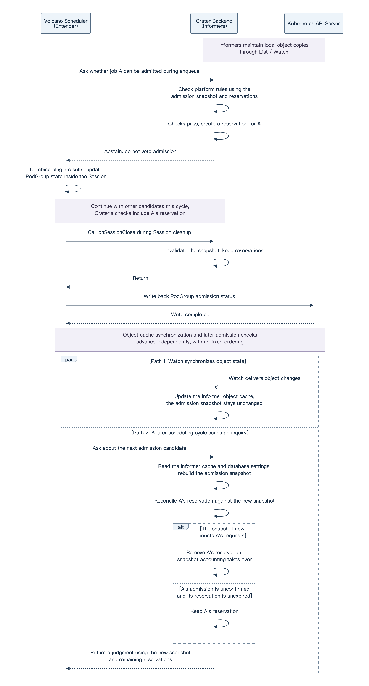

AI Job Admission and Scheduling with Volcano

# Account Mapping and the Job Lifecycle

The previous post introduced Volcano's job organization and scheduling workflow. This time, we return to [Crater](https://github.com/raids-lab/crater), the AI cluster management platform we develop, to explain how it uses Volcano to manage jobs and enforce the platform's resource usage rules.

Volcano coordinates resource allocation, while Crater manages users' account memberships, job submissions, and the amount of resources they are allowed to request. We will first map accounts to scheduling resources and follow a job through its lifecycle, then focus on admission control. Two practical problems—large jobs waiting indefinitely, and the trade-off between CPU pinning and resource resizing—will illustrate the engineering decisions behind the platform.

## Mapping Users and Accounts to Volcano Queues

A user in Crater represents a person using the platform. An account organizes members, resources, and permissions, and may correspond to a team. A user can belong to multiple accounts. The account used to submit a job determines which account the job's resource requests belong to.

Volcano organizes resource allocation through Queues, so Crater maps accounts and their members to Queues. Public and non-public accounts use different structures:

```text
Crater public account
└── Public Queue: default
    ├── Jobs submitted by User A through the public account
    └── Jobs submitted by User B through the public account

Crater non-public account X
└── Account parent Queue
    ├── User A's child Queue within account X
    │   └── Jobs submitted by User A through account X
    └── User B's child Queue within account X
        └── Jobs submitted by User B through account X
```

Under the public account, jobs from multiple users enter the same public Queue directly. For a non-public account, Crater creates an account parent Queue and a user child Queue for each member. Jobs enter the corresponding user child Queue. The account parent Queue represents resource settings for the whole account, while each user child Queue represents that member's resource settings within the account. A user belonging to two non-public accounts therefore has two separate user child Queues.

An account is a Crater platform concept, while a Queue is a Volcano scheduling resource. The mapping above connects them. When this post refers to a job's Queue, it means the Queue explicitly specified in the job declaration. For a non-public account, this is the user child Queue.

This mapping primarily expresses resource attribution, shares, and upper bounds. When creating or updating Queues, Crater does not assign different `spec.priority` values. The hierarchy between an account parent Queue and its user child Queues does not indicate relative priority either. Volcano coordinates allocation across Queues using the configured scheduling policies; we will discuss the relevant constraints alongside each mechanism.

## Separating Checks by What Happens When They Fail

Once a job's account is established, the platform still needs to decide whether the job can proceed. Some failures require a revised request, while others can be resolved by waiting for conditions to change. They call for different responses.

- If parameters are invalid, or a single job requests more resources than its allowed upper bound, waiting for other jobs to finish will not help while the request and rules remain unchanged. The platform should return an error so the user can adjust the request and resubmit it.
- If the request itself is within the upper bound, but the same user's existing jobs have temporarily used up their total allowance, the platform can keep the job and reconsider it after other jobs finish. The user should not have to submit it repeatedly.

We therefore arrange checks in two stages. Problems needing immediate feedback are checked before creating the job wherever possible; a failure returns an error. We call this stage submission validation. Conditions that can improve while a job waits are checked after creation to determine whether the job may now participate in resource allocation. We call this scheduling admission.

Originally, the Crater backend handled both stages. It validated submission requests and maintained waiting jobs, repeatedly checking whether they could proceed. Volcano already has an `enqueue` admission stage and supports calls to external services through its Extender plugin, so we integrated our admission rules there. Crater still handles submission validation, while Volcano initiates subsequent admission checks and calls Crater to evaluate platform rules. Their responsibilities are as follows:

| Comparison | Submission validation | Scheduling admission |
| --- | --- | --- |
| What is checked, and when | The user's creation request, before creating the job object. | An existing job, during Volcano scheduling cycles. |
| Who drives the process | The Crater backend processes the request and runs the checks in sequence. | The Volcano scheduler drives admission and calls Crater to check platform rules. |
| What happens on failure | An error is returned and the job is not created. The user adjusts the request or resolves the relevant condition before resubmitting. | The job is not admitted this time, but is retained for reconsideration in later cycles using the state available then. |

The actual division also depends on what can be checked, implementation cost, and how users are expected to respond. Account balances and storage usage can change, for example, but Crater still checks them at submission and returns an error if they do not meet the requirements. The two stages therefore do not strictly correspond to permanent and temporary failures, or to static and dynamic checks.

## From Request Validation to Running Containers

The Crater backend first validates a submitted job. The checks vary by job type and enabled features, but mainly include:

- Request and permissions: validate parameters, mount permissions, and whether the user is banned from submitting jobs.
- Job counts: check the user's job count limit within the account, along with the applicable limits for interactive jobs.
- Billing and storage conditions: when enabled, check whether the user's Crater billing credit balance allows job creation and whether their storage usage has reached its quota.
- Per-job resource upper bound: check whether this job's requested CPU, memory, GPUs, or other resources exceed the applicable per-user upper bounds.
- Placement precheck: simulate placing the job's Pods using node allocatable capacity and selected node constraints to catch requests that clearly cannot fit. This check does not subtract other jobs' current allocations, bind Pods, or reserve nodes.

Once validation passes, Crater constructs a Volcano Job, or VCJob, and creates it through the Kubernetes API Server. Controllers and the scheduler then advance the job, with Crater continuing to participate through admission callbacks. The table below follows the object changes and the components responsible for them. Step ③ is scheduling admission.

| Stage | Main component responsible | Processing and result |
| --- | --- | --- |
| ① Create the job declaration | Crater backend | Save the validated request as a VCJob, including its workload, resource requests, user, and Queue. |
| ② Establish the scheduling group | Volcano Job Controller | Create a corresponding PodGroup declaring the job's minimum group requirements and Queue membership for the scheduler. |
| ③ Decide whether to admit the job | Volcano Scheduler and Crater backend | During `enqueue`, Volcano calls Crater through Extender and combines the configured plugins' judgments. The result is reflected in the PodGroup's scheduling status. |
| ④ Create the job's Pods | Volcano Job Controller | After observing that the PodGroup has been admitted, create Pods from the templates and replica counts of the VCJob's Tasks. |
| ⑤ Assign nodes | Volcano Scheduler | Attempt placement for pending Pods, check Queue resource constraints, node conditions, and group requirements, and submit bindings that satisfy them. |
| ⑥ Start the programs | kubelet and the container runtime on each target node | Prepare storage, devices, and images for bound Pods, start their containers, and report runtime status. |

As explained in the previous post, admission grants permission to participate in subsequent resource allocation. The job may still need to wait for suitable nodes and enough resources to meet its group requirements.

We will now focus on step ③: how Volcano calls Crater, and how Crater checks platform rules and maintains quota accounting. The discussion follows Crater's [Extender admission implementation](https://github.com/raids-lab/crater/pull/514). Optional rules apply when their corresponding settings are enabled.

# Scheduling Admission: Platform Decisions and Quota Accounting

Admission determines which submitted jobs can now proceed to resource allocation. Within a scheduling cycle, Volcano examines admission candidates one by one and tries to advance all eligible jobs; it does not select just one. We will follow a single admission callback, then examine how Crater maintains consistent resource accounting across a sequence of checks.

## Integrating Platform Decisions into Volcano Admission

Rather than implementing another scheduler, Crater exposes HTTP endpoints in its backend for Volcano's built-in `extender` plugin to call. The plugin runs inside the Volcano Scheduler process, while the user limit and waiting protection logic remains in the Crater backend. Deployment requires enabling the plugin and configuring callback addresses and paths in Volcano, along with enabling the relevant platform rules in Crater.

The previous post introduced Session, the in-process context for one Volcano scheduling cycle. Within it, `enqueue` examines candidates in the configured Queue and job order, invoking admission judgment functions. When Extender is reached, it sends the current job's information to Crater and returns the response to the scheduling workflow.

```text
Volcano's enqueue selects an admission candidate
    → Extender sends an admission inquiry to Crater
    → Crater checks platform rules and returns its judgment
    → Volcano combines plugin results to decide admission
    → Continue checking other candidates in this cycle
```

The inquiry concerns the whole job. Its payload is Volcano's internal `JobInfo`, rather than an individual Pod or the original VCJob JSON. Crater identifies the corresponding VCJob from the included PodGroup and its `ownerReferences`, then retrieves job information and platform settings from its own admission snapshot. We will examine the snapshot's data sources shortly. The current implementation handles VCJob-managed objects in the configured job namespace; other objects are outside these platform checks.

Crater's normal responses use two voting results.

| Return value | Meaning | Effect on the job |
| --- | --- | --- |
| `Reject` (-1) | Do not admit the job this time. | The job keeps waiting and can be reconsidered in later cycles. |
| `Abstain` (0) | Crater does not veto admission. | Volcano's other plugins continue judging; this does not establish final admission. |

Returning `Abstain` after a successful check preserves the other plugins' opportunity to evaluate the job. Volcano organizes voting into configured tiers, or groups of plugins. If a tier contains a `Permit` and no `Reject`, the admission judgment succeeds and later tiers are skipped. Crater therefore does not use `Permit` to mean that platform checks passed. Even if Crater does not veto a job, Volcano may still decline admission because of Queue resource constraints or other conditions.

## Per-User Resource Request Limits Within a Queue

First, consider what Crater needs to check. Volcano Queue resource settings constrain the whole Queue: `spec.capability` expresses its upper bound, for example, while `spec.deserved` expresses its deserved share. A public Queue contains multiple users, however, and limiting the Queue as a whole does not limit each user's requests.

Crater therefore maintains an additional per-user resource request limit for each configured Queue in its database. A set of CPU, memory, GPU, and other upper bounds is configured for a Queue and applies separately to each user in it, limiting the total resources that user may have admitted at once. Queues without this configuration do not apply this limit. This is a Crater platform rule, evaluated through the admission callback.

Which jobs count toward that total follows from the meaning of admission. An admitted job has permission to participate in resource allocation and must count even before it runs. Otherwise, multiple jobs waiting for nodes could all pass the limit check and later receive resources, collectively exceeding the user's upper bound. Crater therefore counts resource requests from admitted jobs that have not finished. Jobs still waiting for admission do not directly count toward this total.

In the implementation, a PodGroup with a nonempty phase other than `Pending` is treated as admitted. Crater also checks whether the VCJob has reached a terminal state to determine whether its requests still count. PodGroup scheduling status and VCJob lifecycle status serve different purposes; checking whether Pods are running is insufficient.

This resource accounting also differs from billing credits. A resource limit constrains the amount admitted at the same time. Once a job finishes and the accounting reflects that, the allowance becomes available again. Billing credits are Crater's unit for resource usage costs, calculated from resource quantities, unit prices, and billable duration. Deducted credits are not automatically returned when a job finishes. The admission callback does not deduct credits or settle charges.

## Building the Basis for Admission Decisions from Object Watches

To calculate this usage, Crater needs to know other jobs' admission and completion states. A callback asks about one candidate; it does not hand Crater the latest state of the entire cluster. Crater therefore tracks Kubernetes objects independently and organizes the data needed for admission checks.

Kubernetes client Informers perform this synchronization. Running inside the Crater backend process, they use the API Server's List / Watch interfaces to obtain and continuously update local copies of objects such as VCJobs, PodGroups, and Queues. We will call this the Informer object cache. It stores object specifications and status, rather than directly supplying the per-user usage totals needed for admission checks.

Admission inquiries travel through HTTP callbacks, while object state is synchronized through List / Watch. These paths do not complete in lockstep. A change inside Volcano has not necessarily been written to the API Server, and a successful write does not mean Crater's Informer object cache has received it yet.

To reuse prepared data across a batch of admission checks, Crater reads jobs and Queues from its Informer object cache and platform settings from the database, organizing them into an admission snapshot. Subsequent checks reuse this snapshot instead of rereading the object cache or querying the API Server each time. The data sources and their uses are as follows.

| Data source | Information used for admission |
| --- | --- |
| VCJobs in the Informer object cache | User, Queue, resource requests, lifecycle state, creation time, waiting conditions, and declared node scope. |
| PodGroups in the Informer object cache | Associations with VCJobs, scheduling admission status, and minimum resource requirements. |
| Volcano Queues in the Informer object cache | Resource settings such as `capability`, and parent relationships. |
| Crater database | Platform feature switches and per-user resource upper bounds for each configured Queue. |

The snapshot associates VCJobs with PodGroups and produces the usage totals described earlier. Declared node scopes are used for waiting protection, discussed later. Volcano remains responsible for actual node placement; Crater does not calculate each node's remaining resources here.

Volcano's Session and Crater's admission snapshot live in separate processes. The former supports the entire scheduling cycle, while the latter serves platform checks. Crater uses an end-of-cycle callback to keep snapshot rebuilding broadly aligned with Session cycles; we will cover that handoff shortly. In the meantime, the Informer object cache keeps updating, while an existing admission snapshot remains unchanged until it is rebuilt.

Reusing a snapshot gives a batch of checks a consistent data basis, but does not make it a globally atomic snapshot. VCJobs, PodGroups, and Queues are read separately from the Informer object cache when building it, and may be at different stages of synchronization.

## Temporary Quota Reservations Across Consecutive Admission Checks

When several jobs are considered in sequence, the timing of admission state writes and synchronization affects limit checks. After admitting a job, Volcano first updates its PodGroup state inside the Session. It writes that state back to the API Server during cleanup when the Session closes at the end of the cycle. Crater therefore cannot learn the preceding decisions through Informers while subsequent candidates are checked in the same cycle, even if it rebuilds the snapshot. Watch delivery and cache updates may introduce further delay after the write.

Suppose one user may request up to eight GPUs in a Queue. Their admitted jobs already request four GPUs, and candidates A and B each request another four. After A passes the checks, B would also pass if it still saw only the original four GPUs in use. If both were ultimately admitted, their total would reach twelve GPUs.

To cover this gap, Crater creates a temporary reservation before returning a non-veto for a candidate that passes platform checks and whose minimum requirements fit within the Queue's configured upper bounds. Subsequent checks read both the snapshot and reservation records, evaluating each constrained resource separately:

```text
For the same user within the same Queue

Requests of admitted, unfinished jobs counted in the snapshot
+ Temporary reservations for other jobs
+ The current candidate's request
≤ The per-user upper bound configured for that Queue
```

Once A leaves a four-GPU reservation, B sees `4 + 4 + 4 > 8` and is not admitted this time. The reservation affects only Crater's resource limit accounting. It does not lock nodes, allocate GPUs, or deduct billing credits in advance.

Reservations are recorded per job. When the same job is checked again, Crater excludes its existing reservation before adding the current request, avoiding double counting. A successful check updates the existing record and timestamp rather than adding another reservation. The snapshot can therefore remain unchanged while reservations added or refreshed by each callback participate in subsequent checks.

Putting these pieces back into a single callback, platform rules run in the following order. This assumes the platform's overall feature switch is enabled and omits protocol parsing and error handling. The waiting protection conditions will be explained in the next chapter.

```text
Confirm that the candidate is a VCJob within Crater's scope
Reuse the admission snapshot, or build a new one

If the VCJob is not yet present in the snapshot
    Return Reject and wait for a later retry
If user limits are enabled and adding this request exceeds them
    Return Reject
If a waiting protection rule blocks the current candidate
    Return Reject

If the job's minimum requirements exceed the capability
of its Queue or an ancestor Queue
    Return Abstain without a reservation; let Volcano continue judging

Create or update this job's temporary reservation
Return Abstain
```

The final `capability` check only determines whether to create a reservation; it does not replace Volcano's Queue checks. If the minimum requirements already exceed the configured upper bound, a reservation would keep occupying the user's allowance without helping the job gain admission, so this path does not reserve it. Other candidates may leave a reservation and still be rejected by a later Volcano plugin. Reservations are therefore conservative accounting, rather than proof of final admission.

## State Synchronization and the Accounting Handoff Between Cycles

Temporary reservations cannot be removed as soon as a callback returns or all cleared when a Volcano cycle ends. Until the new admission state enters Crater's accounting, the reservation continues to bridge that gap.

Crater also exposes an `/onSessionClose` endpoint to connect scheduling cycles. With the corresponding Extender callback configured, Volcano notifies Crater when closing a Session, invalidating the existing admission snapshot. On the next valid admission inquiry, Crater reads objects from the Informer object cache and platform settings from the database to build a new snapshot, then reconciles existing reservations one by one. This step does not query the API Server directly for the latest state.

The sequence below brings the two communication paths together, using job A passing platform checks and ultimately gaining admission as an example. Extender runs inside the Volcano scheduler, and Informers run inside the Crater backend.



The cleanup order shown follows Volcano v1.15.3.

The final two paths advance independently. A Watch update may arrive before or after the next admission inquiry. `onSessionClose` does not carry the latest state or wait for Crater's Watch to catch up, so a new snapshot may still miss the admission decision just made. Snapshots and reservations must therefore be handled separately rather than cleared together when the notification arrives.

| Event | Admission snapshot | Temporary reservations |
| --- | --- | --- |
| Informer receives an object change | Only the Informer object cache is updated; the existing admission snapshot is not recalculated. | Not removed directly by an individual Watch event. |
| `onSessionClose` arrives | Invalidate the old snapshot and rebuild it on the next inquiry. | Retain them until the new snapshot confirms the outcome. |
| A new snapshot is built | Read objects from the Informer object cache and settings from the database; total requests from admitted, unfinished jobs. | Remove reservations whose requests are now counted in the snapshot to avoid double counting. Records for finished or disappeared jobs are also cleared. Unconfirmed, unexpired reservations remain. |
| The same job passes platform checks again | The existing snapshot may be reused. | Update that job's record and timestamp. |

This handoff concerns platform limit accounting. Actual node resources are released as jobs exit and Pods are cleaned up.

The implementation also includes supporting mechanisms. For example, after a prolonged absence of `onSessionClose` notifications, a subsequent admission inquiry triggers a rebuild once the snapshot is also old enough. Otherwise, the existing snapshot is reused. Temporary reservations also expire, preventing jobs that are no longer being queried from occupying the allowance indefinitely. Less common paths, such as delayed state synchronization or rejection by a later plugin, involve error-handling decisions that are still being discussed and refined. We will leave those details aside here.

## Plugin Configuration and Failure Handling

These checks also depend on plugin placement and failure policy. Crater's integration configuration puts `extender` and `capacity` in the same tier, with `extender` running first.

There are two reasons for this arrangement. First, on some successful admission judgment paths, `capacity` immediately increases its resource accounting for jobs entering the Queue in the current cycle. If it records that increase before Crater vetoes the job, the earlier accounting is not automatically rolled back. Second, a tier's `Permit` may end judgment before later tiers run. Placing Extender and resource checks in unsuitable tiers can therefore cause checks to be skipped.

Failures do not all result in rejection.

- If the candidate VCJob is not yet in Crater's admission snapshot, Crater returns `Reject`, waiting for the Informer to synchronize the object and for a later snapshot rebuild to include it.
- If reading settings or building the snapshot fails, the current Crater implementation logs the error and returns `Abstain`. Platform rules are not evaluated for that inquiry.
- If the callback request fails or times out, Volcano follows `extender.ignorable`. Crater's example configuration sets it to `true`, causing Extender to return `Permit` in this case. Other plugins in the same tier can still veto, but Crater's limits and waiting protection cannot constrain this admission attempt.

Reservations also live only in the Crater backend process's memory, so the current scheme assumes a single backend instance. Separate replicas would maintain separate records, and a restart or rolling update can move requests to an instance without the old reservations, losing records whose accounting handoff has not finished. This is not a quota transaction shared across instances. Our current Deployment sets backend `replicas` to 1, so we are not running multiple replicas in parallel. Other components, such as scheduled tasks and experimental schedulers, also depend on a single instance. Designing a separate coordination mechanism for this alone would be disproportionate to our current needs, and would take us beyond scheduling and admission.

We have now covered the overall integration between Crater and Volcano. Getting the workflow connected, however, does not mean it is ready for every practical need. Real usage brings additional problems that call for adjustments.

The next two examples show how these engineering decisions translate into platform behavior. The first is large jobs waiting indefinitely: when small jobs keep consuming fragmented resources, how can we leave an opportunity for a job that needs more resources to start? The second is the trade-off between CPU pinning and resizing resources while a job runs. We want some jobs to benefit from pinning, while also allowing CPU and memory requests to be adjusted when needed. Let's start with large jobs waiting for resources.

# Protecting Waiting Large Jobs: Resource Utilization and Fairness

## Large-Job Starvation as Small Jobs Keep Taking Available Resources

Suppose a node has eight GPUs, four of which are already occupied. A large job arrives whose single Pod needs all eight GPUs, so it must wait for the existing job to release resources. After it, the same Queue receives several small jobs, each needing one GPU on this node.

Must these small jobs wait until the eight-GPU job starts? As discussed in the previous post, Volcano Queues do not guarantee first-in, first-out (FIFO) behavior. Scheduling policy determines the order in which jobs are attempted, but if an earlier job cannot receive an allocation, the scheduler can continue trying other candidates. Later jobs do not all have to stop and wait.

The later one-GPU jobs may therefore take the remaining GPUs first. If small jobs keep arriving, they may claim GPUs as soon as others release them. The node keeps completing work, but never accumulates eight free GPUs. The large job is repeatedly passed over and cannot start for an extended period: large-job starvation. Using fragmented resources improves utilization, but may compromise fairness for large jobs waiting to start. Multi-Pod jobs with group requirements can encounter a similar problem.

We therefore added waiting protection. While a job has waited only briefly, other jobs can continue competing for resources. Once it exceeds a configured waiting threshold and meets the protection conditions, Crater temporarily defers admission of competing jobs, giving resources released later a chance to accumulate. This accepts some temporary idle capacity in exchange for an opportunity for a long-waiting job to start.

## Waiting Thresholds, Eligibility, and the Scope of Competition

At submission, Crater writes the configured waiting tolerance into a VCJob annotation. Admission checks measure elapsed time from the job's creation; the clock is not restarted after admission. The VCJob must also be in its initial or `Pending` phase. Without a valid positive waiting duration, protection is not triggered.

Exceeding the waiting threshold is a protection condition. It does not prove starvation, nor require the job to request a large amount of resources. Its admission progress then determines whether it can hold back other jobs from entering allocation.

| Waiting job's state | Protection conditions |
| --- | --- |
| Admitted, still waiting for nodes | A PodGroup in `Inqueue` or `Unknown` can block other admission candidates within its competition scope, including candidates that have also exceeded their waiting thresholds. |
| Not yet admitted | The job must itself pass the per-user resource limit check, and its minimum resource requirements must fit within the `capability` of its Queue and all ancestor Queues. It then blocks only competing candidates that have not yet exceeded their waiting thresholds, leaving other overdue candidates unblocked. |

The latter rule prevents a job blocked by its own limits from making everyone else wait with it. Likewise, two overdue jobs that have not yet been admitted must not block each other, or neither could proceed.

Protection applies to candidates that may compete for relevant resources. The current implementation checks three conditions together.

- Same Queue. This compares the Queue actually specified by each job. Users in the public account can affect each other, while jobs in separate user child Queues under the same non-public account do not block each other merely because they share an account parent Queue.
- Resource types match the competition rules. A job requesting no extended resources, such as GPUs, only restricts candidates that also request no extended resources. A job requesting extended resources can restrict candidates requesting exactly the same set of extended resource names. It can also restrict candidates requesting no extended resources, because those jobs may still consume the CPU and memory it needs.
- Declared node scopes may overlap. Crater checks for overlap using explicit hostname constraints. If the scope cannot be determined, it assumes overlap is possible. This judgment uses declared constraints rather than rerunning Volcano's full node filtering logic.

When an admission callback finds a waiting job meeting these conditions, Crater returns `Reject` for the current candidate. This is reevaluated on subsequent checks using the admission snapshot, rather than stored as a permanent block. Once the waiting job starts, finishes, or no longer meets the relevant conditions, it stops blocking other candidates on that basis.

## The Roles of Admission Restrictions and Node Placement

Waiting protection gives resources time to accumulate, but the eight GPUs requested by a single Pod must still be available on the same node. We pair protection with Volcano's `binpack` plugin, including GPUs in its scoring so that small GPU-requesting jobs are placed more closely together, reducing fragmentation. This placement approach is called bin packing and helps leave whole nodes available for large jobs.

There may also be a better answer for our particular setting if we step back from the technical view and look at cluster management. Jobs that genuinely require all eight GPUs are uncommon in our cluster, and students with frequent demand for that scale usually have access to other servers. In these cases, instead of making scheduling-level guarantees or adjustments for large jobs, we can ask students who need eight GPUs to contact us and arrange exclusive access to a node, clearing its existing workloads if necessary.

# After Admission: CPU Pinning and Resource Resizing

CPU pinning here means that the kubelet assigns a container an exclusive set of logical CPUs and runs it on those CPUs, reducing interference from other containers competing for CPU time. Some jobs need pinning for more stable performance.

Where does the problem arise? Some jobs request substantial CPU and memory but consistently use much less, while other jobs wait for lack of resources. We want administrators to lower those requests without interrupting the running work, freeing room for later jobs. Kubernetes in-place resource resizing, however, currently does not support Pods receiving exclusive CPUs through the static CPU management policy. Dynamic resizing and CPU pinning therefore conflict.

The pinning policy is also configured per node, without a direct switch to enable or disable it for each job. Turning off the node's policy to let some jobs resize would remove pinning from other jobs that need its performance benefits. We need to preserve the node policy while allowing each job to choose.

We found that Pod resource settings provide that choice. CPU Manager's `static` policy gives exclusive CPUs only to eligible containers. One condition is that the Pod belongs to the `Guaranteed` QoS class, requiring each container's CPU and memory `requests` to equal their corresponding `limits`. By changing whether these values match, we can keep the node policy and let default jobs use the shared CPU pool.

Crater therefore leaves CPU pinning disabled by default, making it easier for administrators to adjust CPU and memory while a job runs. Users who need pinning can enable it at submission, and the platform generates the corresponding resource settings.

| Mode | Resource settings at submission |
| --- | --- |
| Resource resizing allowed by default | Keep `requests` unchanged, set CPU `limits` to the request plus `1m`, and memory `limits` to the request plus `1Mi`. This keeps the Pod in the shared CPU pool and preserves the ability to resize CPU and memory while it runs. |
| User opts into CPU pinning | Set CPU and memory `requests` equal to their corresponding `limits`. With the Pod meeting `Guaranteed` requirements and containers requesting integer numbers of CPUs, among other conditions, they receive exclusive CPUs and accept the restriction on in-place resizing. |

`1m` is one-thousandth of a CPU. This small difference changes the Pod's resource configuration conditions without increasing its requests or requiring a node policy change for an individual job. Actual resizing uses Kubernetes' Pod `/resize` API. When lowering memory, Crater reduces only `requests` and keeps the original `limits`: this reduces the declared request and does not force the application to release memory it is actually using.

# Closing Thoughts

I had hoped to finish at least this post during the National Day holiday in early October. Most of the core ideas were already worked out by then, but one thing after another still pushed it back until now. 😭
