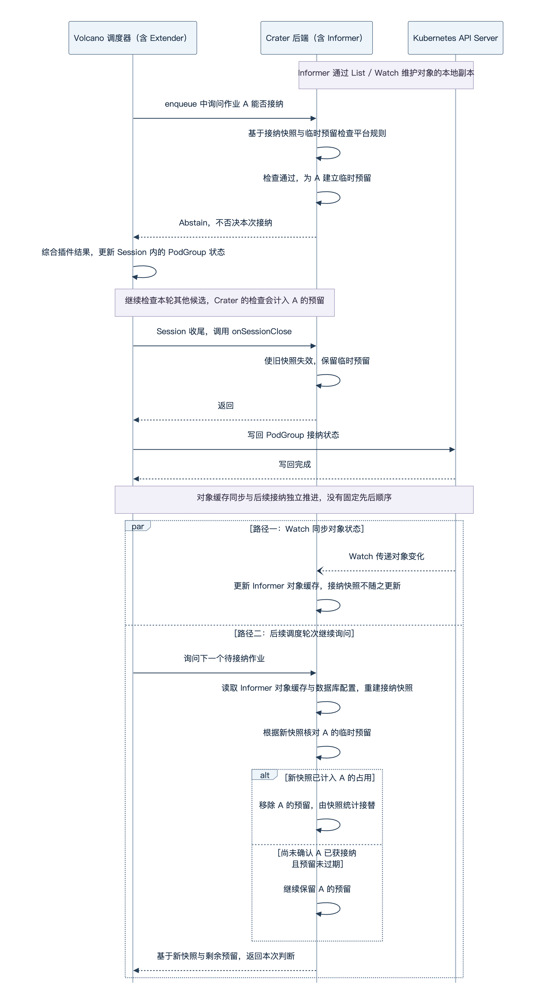

基于 Volcano 的 AI 作业接纳与调度

# 账户映射与作业的完整路径

上一篇介绍了 Volcano 的作业组织与调度流程，这一篇回到我们开发的 AI 集群管理平台 [Crater](https://github.com/raids-lab/crater)，介绍它怎样借助 Volcano 管理作业，并接入平台的资源使用规则。

Volcano 负责协调资源分配，Crater 则管理用户的账户归属、作业提交和允许申请的资源规模。本文先梳理账户映射和作业路径，重点说明接纳控制，再结合大作业长期等待、CPU 绑核与资源调整两个实际问题，介绍平台的工程取舍。

## 用户、账户与 Volcano Queue 的对应关系

Crater 的用户代表使用平台的人，账户用于组织成员、管理资源与权限，可以对应一个团队。一个用户可以加入多个账户，提交作业时使用的账户决定这项作业的资源归属。

Volcano 用 Queue 组织资源分配，Crater 因此将账户和成员映射为相应的 Queue。公共账户与非公共账户采用不同的组织方式：

```text
Crater 公共账户
└── 公共 Queue：default
    ├── 用户甲通过公共账户提交的作业
    └── 用户乙通过公共账户提交的作业

Crater 非公共账户 A
└── 账户 parent Queue
    ├── 用户甲在账户 A 中的 child Queue
    │   └── 用户甲通过账户 A 提交的作业
    └── 用户乙在账户 A 中的 child Queue
        └── 用户乙通过账户 A 提交的作业
```

公共账户下，多个用户的作业直接进入同一个公共 Queue。非公共账户下，Crater 建立账户 parent Queue 和各成员的用户 child Queue，作业进入对应的用户 child Queue。账户 parent Queue 表达整个账户的资源配置，用户 child Queue 表达某个成员在这个账户中的资源配置。同一个用户加入两个非公共账户，就会对应两个不同的用户 child Queue。

账户是 Crater 的平台概念，Queue 是 Volcano 的调度资源，两者通过上述规则关联。后面提到“作业所属 Queue”，指的是作业声明中实际指定的 Queue，在非公共账户场景下就是用户 child Queue。

这套映射主要用于表达资源归属、份额与上限。Crater 创建和更新 Queue 时不主动设置不同的 `spec.priority`，账户 parent Queue 与用户 child Queue 的层级也不表示优先级高低。各 Queue 之间的资源分配由 Volcano 按配置的调度策略协调，具体约束在后文结合相应机制展开。

## 从失败后的处理方式划分检查阶段

明确作业归属后，平台还需要判断是否允许它继续推进。检查不通过时，有些请求必须修改，有些作业则可以等待条件变化，二者需要不同的处理方式。

- 如果参数无效，或单项作业的资源申请量超过允许上限，在请求和规则不变的前提下，等待其他作业结束也没有用。平台应直接返回错误，让用户调整后重新提交。
- 如果申请量本身没有超限，只是同一用户已有作业暂时占满了允许申请的资源总量，就可以保留作业。已有作业结束后再重新判断，无需让用户反复提交。

基于这种处理需求，我们把检查安排在两个阶段。需要立即反馈的问题，尽量在创建作业之前检查，不通过就返回错误，这一阶段称为“提交校验”。适合等待条件变化的问题，则在作业创建后持续考察，决定它现在能否进入资源分配，这一阶段称为“调度接纳”。

早期，两类检查都由 Crater 后端主导，后端既校验提交请求，也维护等待中的作业并反复判断。而 Volcano 已有 `enqueue` 接纳阶段，并支持通过 Extender 插件调用外部服务，因此我们将接纳规则接入这套机制。提交校验仍由 Crater 主导，后续接纳则由 Volcano 发起，回调 Crater 执行平台检查。两者的分工如下：

| 对比项 | 提交校验 | 调度接纳 |
| --- | --- | --- |
| 检查对象与时机 | 用户提交的创建请求，发生在创建作业对象之前。 | 已创建的作业，发生在 Volcano 的调度轮次中。 |
| 谁主导 | Crater 后端处理提交请求，依次执行检查。 | Volcano 调度器推进接纳判断，并调用 Crater 检查平台规则。 |
| 不通过时 | 返回错误，不创建本次作业。用户根据原因修改请求或处理相关条件后重新提交。 | 本次不接纳，保留作业，后续调度轮次根据届时的状态继续判断。 |

实际划分还要考虑检查能力、实现成本和用户的处理方式。例如，余额和存储用量也会变化，但 Crater 仍在提交时检查，不满足就返回错误。因此，两阶段并不严格对应“永久不能通过”和“暂时不能通过”，也不等同于静态检查和动态检查。

## 从请求校验到容器运行

一次作业提交先由 Crater 后端执行校验。检查项随作业类型和功能开关有所不同，主要包括：

- 请求与权限：校验参数、挂载权限，以及用户是否被禁止提交作业。
- 作业数量：检查用户在账户内的作业数量限制，交互式作业还检查相应的数量限制。
- 计费与存储条件：启用相关功能时，检查 Crater 计费点数余额是否满足创建条件，以及用户存储用量是否达到配额。
- 单项作业申请上限：检查这项作业自身申请的 CPU、内存、GPU 等资源量是否超过适用的每用户上限。
- 节点放置预检：根据节点可供 Pod 使用的容量与部分节点约束，模拟本作业各 Pod 的放置，提前发现明显无法放下的申请。这一步不扣除其他作业当前的占用，也不绑定 Pod 或预留节点。

检查通过后，Crater 将请求组织成 Volcano Job，简称 VCJob，通过 Kubernetes API Server 创建对象。随后由控制器和调度器推进，Crater 通过接纳回调继续参与判断。下面沿着对象变化看各组件怎样衔接，其中第③步就是调度接纳。

| 阶段 | 主要由谁推进 | 处理内容与阶段结果 |
| --- | --- | --- |
| ① 创建作业声明 | Crater 后端 | 将通过提交校验的请求保存为 VCJob，包含运行内容、资源申请、所属用户与 Queue 等信息。 |
| ② 建立调度分组 | Volcano Job Controller | 为 VCJob 创建对应的 PodGroup，表达作业的最低成组要求和 Queue 归属，供调度器判断。 |
| ③ 判断能否接纳 | Volcano Scheduler 与 Crater 后端 | Volcano 在 `enqueue` 中通过 Extender 调用 Crater，并综合配置中的插件判断，结果体现在 PodGroup 的调度状态中。 |
| ④ 创建作业 Pod | Volcano Job Controller | 控制器观察到 PodGroup 获得接纳后，根据 VCJob 中各 Task 的 Pod 模板和副本数创建 Pod。 |
| ⑤ 分配节点 | Volcano Scheduler | 为待调度 Pod 尝试节点分配，检查所属 Queue 的资源约束、节点条件和成组要求，再提交符合条件的绑定。 |
| ⑥ 启动程序 | 目标节点上的 kubelet 与容器运行时 | 为已绑定的 Pod 准备存储、设备和镜像，启动容器，并反馈运行状态。 |

通过上一篇博客我们可以知道：通过接纳，只表示获准参与后续资源分配，作业仍可能等待合适的节点与足够的成组资源。

接下来重点展开第③步，说明 Volcano 怎样回调 Crater，以及 Crater 怎样执行平台检查并维护配额记账。本文以 Crater 的 [Extender 接纳实现](https://github.com/raids-lab/crater/pull/514)为主线，涉及的可选规则均以相应配置启用为前提。

# 调度接纳：平台判断与配额记账

接纳阶段要解决的是，哪些已提交的作业现在可以继续参与资源分配。Volcano 在一轮调度中会逐个检查待接纳候选，尽量推进符合条件的作业，并不只挑一个作业。本章沿着一次接纳回调展开，再看连续处理多个作业时，Crater 怎样维持资源统计的一致性。

## 将平台判断接入 Volcano 的接纳流程

Crater 没有另写一个调度器，而是在后端提供 HTTP 接口，供 Volcano 自带的 `extender` 插件调用。插件运行在 Volcano Scheduler 进程中，用户限额和等待保护的代码仍运行在 Crater 后端。部署时需要在 Volcano 配置中启用插件、指定回调地址与路径，同时开启 Crater 对应的平台规则。

上一篇介绍过 Session，它是 Volcano 一轮调度使用的进程内上下文。`enqueue` 在其中按配置的 Queue 和作业顺序检查候选，调用接纳判断函数。轮到 Extender 时，插件将当前作业的信息发送给 Crater，再把收到的结果交回调度流程。

```text
Volcano 的 enqueue 选取一个待接纳作业
    → Extender 向 Crater 发送接纳询问
    → Crater 检查平台规则并返回判断
    → Volcano 综合插件结果，决定本次是否接纳
    → 继续检查本轮其他候选
```

询问针对整项作业，传入的是 Volcano 内部的 `JobInfo`，不是某个 Pod，也不是原始 VCJob 的 JSON。Crater 根据其中的 PodGroup 及其 `ownerReferences` 确定对应 VCJob，再从自己的接纳快照中取得作业信息与平台配置。快照的数据来源在后面展开。当前实现只处理指定作业命名空间内、由 VCJob 管理的对象，其他对象不受这套平台检查约束。

Crater 的正常响应只有两种投票结果。

| 返回值 | 表达的判断 | 对作业的影响 |
| --- | --- | --- |
| `Reject`（-1） | 本次不允许接纳。 | 作业继续等待，后续轮次可以重新判断。 |
| `Abstain`（0） | Crater 不否决本次接纳。 | 继续由 Volcano 的其他插件判断，不代表最终接纳成功。 |

检查通过时返回 `Abstain`，是为了保留其他插件的判断机会。Volcano 按配置中的 tier，也就是插件组层级，组织投票。某一层有 `Permit` 且没有 `Reject` 时，就会通过接纳判断，不再检查后续层级。因此，Crater 不用 `Permit` 代替“平台检查通过”。即使 Crater 不否决，Volcano 仍可能因 Queue 的资源约束等条件不接纳这个作业。

## Queue 内每用户资源申请上限

先看 Crater 要检查什么。Volcano Queue 的资源配置约束整个 Queue，例如 `spec.capability` 表达资源上限，`spec.deserved` 表达应得份额。但公共 Queue 中有多个用户，只限制 Queue 整体并不能限制其中每个人的申请规模。

因此，Crater 在数据库中额外维护“Queue 内每用户资源申请上限”，为指定 Queue 配置一套 CPU、内存、GPU 等上限，分别限制其中每个用户同时获准申请的资源总量。未配置的 Queue 不执行这项限制。这是 Crater 的平台规则，由接纳回调检查。

哪些作业应计入占用，也取决于接纳的含义。已经接纳的作业获得了继续参与资源分配的资格，即使还没有运行，也不能当作不存在。否则，多个等待节点的作业都可能通过限额检查，之后陆续获得资源，合计超过用户上限。因此，Crater 统计的是已接纳、尚未结束的作业申请量，单纯等待接纳的作业不直接计入这项统计。

实现中，PodGroup 的阶段非空且不是 `Pending`，会被视为已接纳，再结合 VCJob 是否进入终态判断是否计入。PodGroup 的调度状态与 VCJob 的生命周期状态各有用途，不能只看 Pod 是否正在运行。

这笔资源账也不同于计费点数。资源限额约束同时获准申请的规模，作业结束并被统计到后，相应空间可以再次使用。计费点数则是 Crater 核算资源使用成本的单位，按资源量、单价和计费时长结算，已扣点数不会因作业结束自动返还。接纳回调不负责扣点或结算。

## 从对象监听建立接纳判断的依据

要计算上述占用，Crater 必须知道其他作业的接纳和结束状态。一次回调只询问一个候选作业，并没有把整个集群的最新状态交给 Crater。因此，Crater 需要独立跟踪 Kubernetes 对象，再整理接纳判断所需的数据。

这项同步由 Kubernetes 客户端的 Informer 机制完成。它运行在 Crater 后端进程中，通过 API Server 的 List / Watch 获取并持续更新 VCJob、PodGroup、Queue 等对象的本地副本。下文将这份数据称为“Informer 对象缓存”。它保存对象的声明和状态，不直接提供接纳检查所需的用户占用汇总。

接纳询问通过 HTTP 回调传递，对象状态通过 List / Watch 同步，两条通信路径不会自动同步完成。Volcano 修改了内部状态，不代表已经写入 API Server。即使写入成功，也不代表 Crater 的 Informer 对象缓存已经收到变化。

为了让一批接纳判断复用整理好的数据，Crater 从 Informer 对象缓存读取作业与 Queue，从数据库读取平台配置，整理成“接纳快照”。后续检查复用这份快照，不会每次都重新读取对象缓存或向 API Server 查询。各类数据的来源与用途如下。

| 数据来源 | 用于接纳判断的信息 |
| --- | --- |
| Informer 对象缓存中的 VCJob | 所属用户、Queue、资源申请量、生命周期状态，以及创建时间、等待条件和声明的节点范围。 |
| Informer 对象缓存中的 PodGroup | 与 VCJob 的关联、调度接纳状态和最低资源要求。 |
| Informer 对象缓存中的 Volcano Queue | `capability` 等资源配置及 parent 关系。 |
| Crater 数据库 | 平台功能开关与各 Queue 对应的每用户资源上限。 |

这份快照将 VCJob 与 PodGroup 关联起来，形成前面所需的占用统计。声明的节点范围用于后面的等待保护，实际节点分配仍由 Volcano 负责，Crater 不在这里计算各节点的剩余资源。

Volcano 的 Session 与 Crater 的接纳快照分别存在于两个进程中。前者支撑整轮调度，后者服务于平台检查，二者不是同一份数据。Crater 借助轮次结束回调，让快照的重建尽量跟随 Session 的轮次，具体交接过程稍后说明。期间 Informer 对象缓存持续更新，已建立的接纳快照则保持不变，直到下次重建。

复用快照让这一批判断使用一致的基础数据，但不意味着它是全局原子快照。建立快照时，VCJob、PodGroup、Queue 从 Informer 对象缓存中分别读取，也可能处在不同的同步进度。

## 连续接纳判断中的临时配额预留

连续判断多个作业时，接纳状态的写回与同步时机会影响限额检查。Volcano 在本轮接纳一个作业后，先修改 Session 内的 PodGroup 状态，到本轮结束、关闭 Session 的收尾阶段才写回 API Server。因此，同一轮内继续询问后面的作业时，Crater 无法通过 Informer 获知前面的接纳决定，即使重建快照也看不到。写回之后，还可能有 Watch 传输和缓存更新的延迟。

假设同一用户在一个 Queue 中最多申请 8 张 GPU，当前已接纳作业申请了 4 张，候选 A、B 各申请 4 张。A 检查通过后，如果 B 仍只看到原来的 4 张占用，就也会通过。两项作业若最终都获接纳，总申请量会达到 12 张。

为覆盖这个空档，对通过平台检查且最低需求未超过 Queue 配置上限的候选，Crater 在返回“不否决”前，先把申请量记入临时预留。后续检查同时读取快照和预留记录，对每种受限资源分别计算：

```text
同一用户、同一 Queue 下

快照中已接纳且未结束的申请量
+ 其他作业的临时预留量
+ 当前候选作业的申请量
≤ 该 Queue 配置的每用户上限
```

这样，A 留下 4 张 GPU 的预留后，B 就会看到 `4 + 4 + 4 > 8`，本次不获接纳。这份预留只占用 Crater 的资源限额统计，不锁定节点、不分配 GPU，也不预扣计费点数。

预留按作业记录。同一作业再次接受检查时，先排除自己的已有预留，再加上本次申请量，避免重复计算。检查通过后更新原记录和时间，不会再增加一份。也就是说，快照可以不变，但每次回调新增或更新的预留会参与后续判断。

将这些数据放回一次回调中，平台规则按下面的顺序执行。这里假设平台总开关已开启，省略协议解析与异常处理，等待保护的具体条件留到下一章。

```text
确认候选属于 Crater 处理的 VCJob 范围
取得可复用的接纳快照，或重新建立快照

若快照中尚未找到该 VCJob
    返回 Reject，等待后续重试
若已启用用户限额，且加入本次申请后超限
    返回 Reject
若当前候选受到等待保护规则限制
    返回 Reject

若作业最低需求超过所属 Queue 或祖先 Queue 的 capability
    返回 Abstain，不建立预留，由 Volcano 继续判断

建立或更新本作业的临时预留
返回 Abstain
```

这里最后的 `capability` 检查只决定是否建立预留，不替代 Volcano 的 Queue 检查。最低需求已经超出配置上限时，保留预留会长期挤占用户的可申请空间，却无法促成接纳，所以这条路径不记预留。其他候选则可能先留下预留，再被 Volcano 的后续插件拒绝。预留因此是保守记账，不是“最终接纳成功”的凭据。

## 跨调度轮次的状态同步与记账交接

临时预留不能在回调结束时删除，也不能在 Volcano 一轮结束时全部清空。只要新的接纳状态还没有进入 Crater 的统计，预留就仍在填补两者之间的空档。

为衔接调度轮次，Crater 还提供 `/onSessionClose` 接口。配置对应的 Extender 回调后，Volcano 关闭 Session 时会通知 Crater，使已有接纳快照失效。下一次有效接纳询问到来时，Crater 再从 Informer 对象缓存读取对象、从数据库读取平台配置，建立新快照，并逐项核对已有预留。这一步不会直接向 API Server 查询最新状态。

下面以作业 A 通过平台检查、最终获准接纳为例，将这两条通信路径放在一起。图中的 Extender 运行在 Volcano 调度器内，Informer 则运行在 Crater 后端内。



上述收尾顺序以 Volcano v1.15.3 为准。

图中最后两条路径独立推进，Watch 更新可能早于或晚于下一次接纳询问。`onSessionClose` 不携带最新状态，也不等待 Crater 的 Watch 追上，因此新快照仍可能看不到刚完成的接纳决定。快照与预留需要分别处理，不能在收到通知时一起清空。

| 事件 | 接纳快照 | 临时预留 |
| --- | --- | --- |
| Informer 收到对象变化 | 只更新 Informer 对象缓存，已有接纳快照不随之重算。 | 不因单次 Watch 事件直接删除。 |
| 收到 `onSessionClose` | 使旧快照失效，下次询问时重建。 | 保留，等待新快照确认结果。 |
| 建立新快照 | 从 Informer 对象缓存读取对象、从数据库读取配置，汇总已接纳且未结束作业的占用。 | 已计入快照占用的申请移除预留，避免重复计算。已结束或已消失作业的记录也会清理，尚未确认且未过期的预留继续保留。 |
| 同一作业再次通过平台检查 | 可以继续复用已有快照。 | 更新该作业的记录及时间。 |

这里交接的是平台限额记账，节点资源的实际释放仍由作业退出和 Pod 清理推进。

实际实现还有一些辅助机制。比如，长时间没有收到 `onSessionClose` 通知时，后续接纳询问会在快照也达到规定时长后触发重建，不满足条件就继续复用已有快照。临时预留也会过期清理，避免不再被询问的作业长期占用限额。状态同步延迟、后续插件否决等较少遇到的分支，还涉及一些仍在讨论和完善的异常处理方式，这里就不再展开了。

## 插件配置与故障时的处理

上面的判断能够生效，还依赖插件位置和失败策略。Crater 的接入配置将 `extender` 与 `capacity` 放在同一个 tier，并让 `extender` 先执行。

这样安排有两个原因。首先，`capacity` 在部分接纳通过路径中就会增加自己的本轮入队资源统计。如果先让它记账，再由 Crater 否决，前面的统计不会自动回滚。其次，某一层的 `Permit` 可能结束后续层级判断，把 Extender 与资源检查分到不合适的层，会产生跳过检查的问题。

故障时的处理也不是统一拒绝。

- Crater 的接纳快照里尚未找到候选 VCJob，会返回 `Reject`，等待 Informer 同步该对象并在后续快照重建时纳入判断。
- 读取配置或构建快照失败时，当前 Crater 实现记录错误并返回 `Abstain`，平台规则在这次判断中未被执行。
- 回调请求失败或超时时，Volcano 按 `extender.ignorable` 处理。Crater 的配置示例使用 `true`，此时 Extender 返回 `Permit`，同一层其他插件仍可否决，但 Crater 的限额与等待保护暂时无法约束这次接纳。

此外也需要意识到，预留只保存在 Crater 后端进程内存中，当前方案要求单后端实例。多副本各自记账，或重启、滚动更新时切换到没有旧预留的实例，都可能丢失尚未完成状态交接的记录。它不是跨实例共享的配额事务。不过在目前我们的 Deployment 配置中，后端的 replicas 是 1，也就是说它只会有一个副本，暂时不涉及这个问题。其它也有些依赖单实例的地方比如定时任务、实验用调度器，这里为此再设计一套机制有点不值，也不是调度或者接纳的事了。

前面已经说明了 Crater 接入 Volcano 的整体流程，但流程打通之后并不是说就好用了，还需要根据实际使用问题进行一些调整。

接下来以我们遇到的两个问题为例说明这些工程取舍怎样落到平台实现中。一个是大作业长期等待。小作业不断用掉零散资源时，怎样给需要更多资源的作业留下启动机会？另一个是 CPU 绑核与运行中资源调整的取舍。我们既希望部分任务获得绑核带来的性能收益，也希望在需要时调整作业申请的 CPU 和内存。下面先从大作业等待说起。

# 大作业等待保护：在资源利用率与公平性之间取舍

## 零散资源被持续占用时的大作业饥饿

假设一个八卡节点上已经有作业占用四张 GPU，此时来了一个单 Pod 需要八张 GPU 的大作业，只能等待已有作业释放资源。在它之后，同一个 Queue 又陆续收到一些只需要一张 GPU 的小作业，它们也要使用这个节点。

这些小作业是否必须等八卡作业启动后才能运行？上一篇博客提到，Volcano 的 Queue 并不保证先进先出（FIFO）。Queue 内的作业有调度策略决定的尝试顺序，但先被尝试的作业暂时无法分配时，调度器可以继续尝试其他候选，不要求后面的作业都停下来等待。

因此，后来的单卡作业可能先用掉剩余 GPU。如果小作业持续到来，刚释放的 GPU 又被占用，节点虽然一直在完成作业，却始终凑不齐八张空闲 GPU。八卡作业被反复越过、长期无法启动，这就是大作业饥饿。继续利用零散资源提高了利用率，却可能牺牲大作业的等待公平性。多 Pod 作业需要满足成组要求时，也可能遇到类似问题。

我们因此增加了等待保护。在作业等待时间较短时，继续允许其他作业竞争资源。等待超过设定阈值后，如果它满足保护条件，就暂缓接纳相关竞争作业，让后续释放的资源有机会积累起来。这相当于接受一部分资源暂时空闲，换取长期等待作业的启动机会。

## 等待阈值、保护资格与竞争范围

Crater 在提交时将配置的等待忍耐时间写入 VCJob 注解。接纳回调以作业创建时间为起点，判断是否超过这个时长，不会在通过接纳后重新计时。VCJob 还必须处于初始或 `Pending` 阶段，没有有效的正数等待时长则不触发保护。

等待超时只是保护条件，并不证明作业已经陷入饥饿，也不限定作业必须申请很多资源。接下来还要根据它的接纳进度判断是否有资格阻止其他作业继续进入分配。

| 等待作业的状态 | 保护条件 |
| --- | --- |
| 已接纳，仍在等待节点 | PodGroup 为 `Inqueue` 或 `Unknown` 时，可以阻止竞争范围内其他候选获接纳，包括同样已经等待超时的候选。 |
| 尚未接纳 | 自身必须能通过用户资源限额检查，最低资源需求也不能超过所属 Queue 或祖先 Queue 的 `capability`。此时只阻止尚未等待超时的竞争候选，不阻止同样已超时的候选。 |

后一个条件是为了避免作业被自身限额拦住，却让其他人一起等待。同样，两个尚未接纳的超时作业也不能互相阻止，否则谁都无法继续推进。

保护只针对可能竞争相关资源的候选，当前实现同时检查三个条件。

- 所属 Queue 相同。比较的是作业实际提交的 Queue。公共账户中的用户可以相互影响，而同一非公共账户下、分别进入不同用户 child Queue 的作业，不会仅因拥有同一个账户 parent Queue 就互相阻塞。
- 资源类型符合竞争规则。未申请 GPU 等扩展资源的作业，只限制同样未申请扩展资源的候选。申请了扩展资源的作业，可以限制所申请扩展资源名称集合完全相同的候选，也可以限制未申请扩展资源的候选，后者仍可能占用所需的 CPU 和内存。
- 声明的节点范围可能重叠。Crater 根据明确的主机名约束判断交集，无法确定范围时按可能重叠处理。这是根据声明作出的判断，不是重新执行 Volcano 的完整节点过滤。

在接纳回调中找到符合上述条件的等待作业后，Crater 就对当前候选返回 `Reject`。这项限制不是永久标记，后续判断会依据接纳快照中的状态重新计算。等待作业开始运行、结束，或不再满足相应条件后，就不再以原来的条件阻塞其他候选。

## 接纳限制与节点分配的边界

等待保护给资源积累留出了时间，但单 Pod 申请的八张 GPU 还必须集中在同一个节点上。我们配合使用 Volcano 的 `binpack` 插件，将 GPU 纳入其评分，让申请 GPU 的小作业在选择节点时尽量集中放置，减少资源碎片。这种放置方式称为装箱策略，有助于为大作业留下完整节点。

不过从另一方面来说，如果我们不拘泥于技术视角，而是跳出技术从管理视角看，或许能够找到我们这个场景下这个问题更好的解决方式。一定需要八卡才能进行的任务在使用我们这个集群中并不常见，有大量这样需求的同学通常会有别的服务器，因此对于这种情况，我们也可以不从调度层面对大作业做出什么保证或者调整，而是让需要八卡的同学联系我们独占甚至排空节点。

# 接纳之后：CPU 绑核与资源调整的取舍

这里所说的 CPU 绑核，是由 kubelet 为容器分配一组独占的逻辑 CPU，让容器在这些 CPU 上运行，减少与其他容器争用 CPU 带来的干扰。有些作业需要通过绑核来获得更稳定的性能。

那这有什么问题呢？有些作业申请了较多 CPU 和内存，运行时却长期用不满，其他作业又因为资源不足而等待。我们希望管理员能在不中断任务的情况下调低这些申请，为后续作业腾出空间。可是这个 Kubernetes 的资源原地调整目前不支持通过静态 CPU 管理策略获得独占 CPU 的 Pod，也就是说动态调整和绑核是冲突的。

而且，绑核策略配置在节点上，并没有一个可以直接为每个作业开启或关闭的开关。我们又不能为了允许部分作业调整资源，就关闭整个节点的绑核策略，让其他有性能需求的作业也失去绑核能力。因此，需要在保留节点策略的同时，让不同作业各自选择。

我们发现，可以利用 Pod 的资源配置来实现这种按作业选择的能力。CPU Manager 的 `static` 策略只为满足条件的容器分配独占 CPU，其中一个条件是 Pod 属于 `Guaranteed` 类别，要求各容器的 CPU、内存 `requests` 与 `limits` 分别相等。通过改变这些值是否相等，我们就能在保留节点策略的同时，让默认作业使用共享 CPU 池。

Crater 因此默认关闭作业的绑核选项，方便管理员在运行中动态调整 CPU 和内存。用户有性能需求时，可以在提交作业时自行开启，平台会据此生成对应的资源配置。

| 模式 | 提交时的处理 |
| --- | --- |
| 默认允许资源调整 | 保持 `requests` 不变，将 CPU 的 `limits` 增加 `1m`，内存的 `limits` 增加 `1Mi`，使 Pod 使用共享 CPU 池，保留运行中调整 CPU、内存的能力。 |
| 用户选择绑核 | CPU、内存的 `requests` 与 `limits` 分别相等，在 Pod 满足 `Guaranteed` 条件、容器申请整数个 CPU 等前提下获得独占 CPU，接受无法原地调整资源的限制。 |

`1m` 是千分之一个 CPU。这点差额用于改变 Pod 的资源配置条件，不会增加它的资源申请量，也不需要为单个作业修改节点策略。实际调整通过 Kubernetes 的 Pod `/resize` 接口完成。另外，Crater 调低内存时只降低 `requests`，保留原来的 `limits`，减少的是申请量，并不会强制应用释放实际使用的内存。

# 结语

本来打算十一期间至少把这篇写完的，当时就把核心内容捋的差不多了，结果还是因为各种各样的事情拖到现在了，哭哭。
